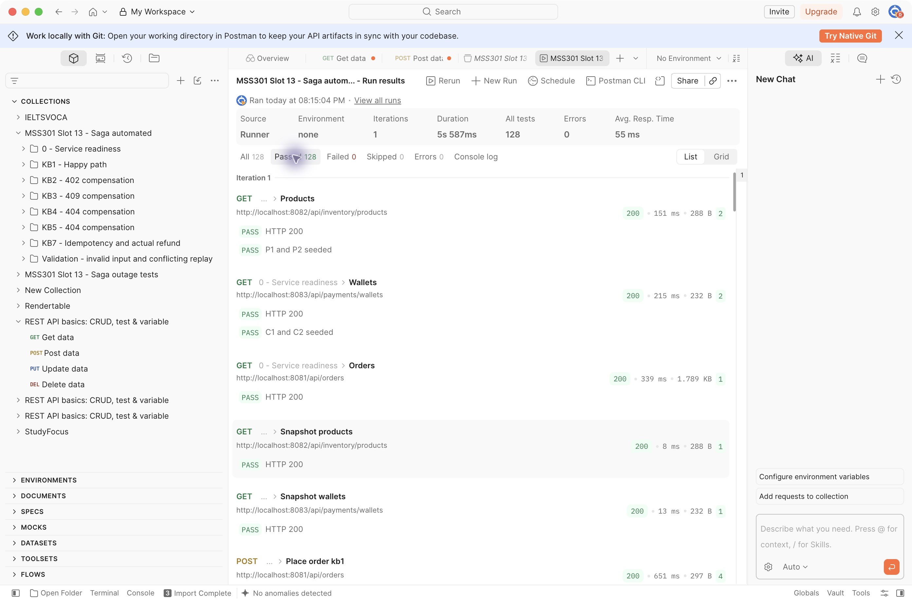
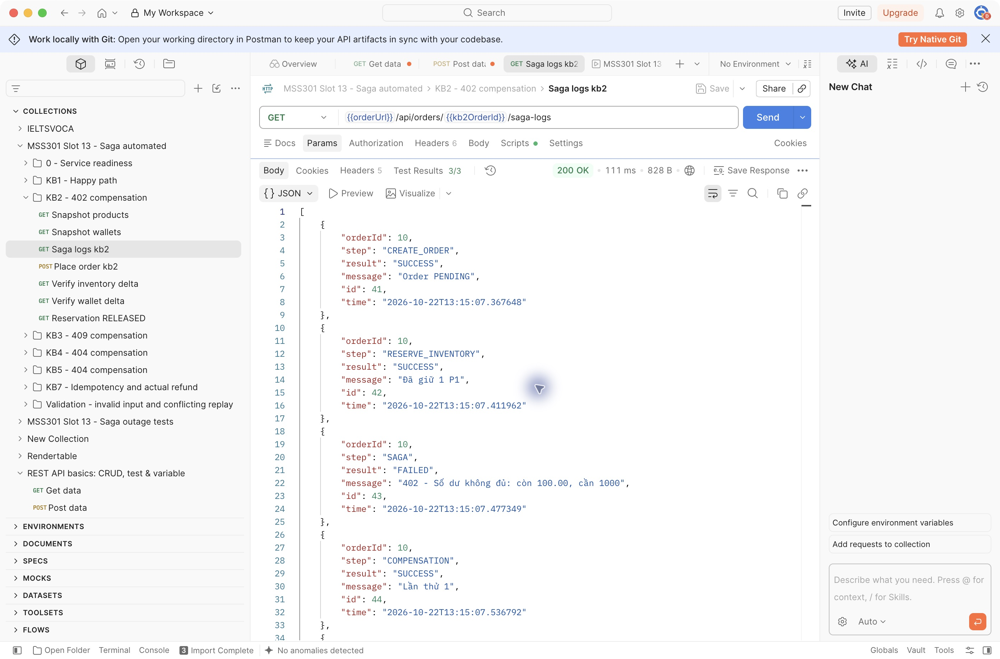
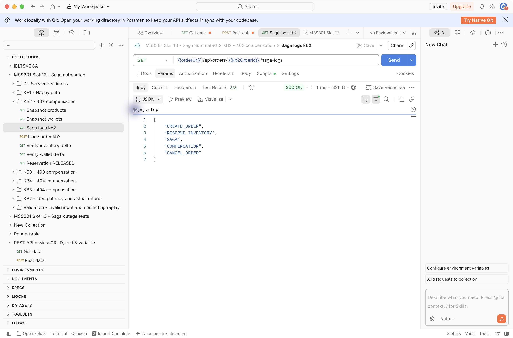

# Kết quả Slot 13 — 22/10/2026 (Asia/Ho_Chi_Minh)

## Kết quả đã chạy thực tế

| Kiểm tra | Kết quả |
|---|---|
| Docker Compose | 3 database + 3 service healthy |
| Maven verify, Java 21 / Boot 4.1.1 | 14 tests, 0 failures/errors/skipped |
| Newman: KB1–KB5, KB7, validation | 64 requests / 128 assertions, 0 failed |
| Postman desktop Collection Runner | 128 tests pass, 0 errors, 1 iteration |
| Newman KB6: Payment offline | 4 requests / 11 assertions, 0 failed |
| Newman KB8: cả hai participant offline | 4 requests / 10 assertions, 0 failed |
| KB6 kiểm tra ví sau khi bật lại | Không đổi |
| KB8 kiểm tra kho khi treo | P2 giảm 1; release thủ công trả lại đúng 1 |

Postman đã import vào **My Workspace**: hai collection Saga và environment Local.
Runner desktop dùng **No Environment**, các URL lấy từ collection variables;
file environment dùng được với Newman và có thể chọn khi chạy trên máy khác.

## Order từ các lần chạy Newman

| KB | Order ID | Order / Saga | Failure reason |
|---|---|---|---|
| KB1 | 1 | CONFIRMED / COMPLETED | — |
| KB2 | 2 | CANCELLED / COMPENSATED | 402 - Số dư không đủ: còn 100.00, cần 1000 |
| KB3 | 3 | CANCELLED / COMPENSATED | 409 - Không đủ hàng: còn 5, cần 100 |
| KB4 | 4 | CANCELLED / COMPENSATED | 404 - Không tìm thấy sản phẩm P9 |
| KB5 | 5 | CANCELLED / COMPENSATED | 404 - Không tìm thấy ví của C9 |
| KB6 | 7 | CANCELLED / COMPENSATED | Service không phản hồi: I/O error on POST request for "http://payment-service:8083/api/payments/pay": null |
| KB8 | 8 | PENDING / COMPENSATING | Service không phản hồi: I/O error on POST request for "http://payment-service:8083/api/payments/pay": null |

ID tự tăng nên kết quả chạy lại có thể khác. Desktop Runner tạo thêm một bộ order mới.
KB6 đã được chạy lại sau khi sửa test để kiểm tra ví sau lúc service hồi phục;
bản report cuối cùng là bản pass được lưu bên dưới.

## Bằng chứng

- [Tổng hợp máy đọc được](../evidence/test-summary.json).
- [Maven verify log](../evidence/verify.log).
- [Newman JSON](../evidence/newman.json), [JUnit](../evidence/newman.xml), [CLI log](../evidence/newman.log).
- [KB6 report](../evidence/kb6-newman.json), [ví trước/sau](../evidence/kb6-wallets.json).
- [KB8 report](../evidence/kb8-newman.json), [ba log compensation lỗi](../evidence/kb8-saga-logs.json), [kho trước/treo/dọn test](../evidence/kb8-stock.json).
- [Outage test log](../evidence/outages.log), [Docker trạng thái](../evidence/docker-ps.json).
- [JSON order theo kịch bản](../evidence/scenario-orders.json).

Các test local transaction dùng database thật, không thay MongoDB/SQL Server bằng mock.
Orchestrator unit test dùng mock participant để chủ động kiểm chứng lỗi confirm,
LIFO refund → release → cancel và hai trường hợp retry thành công/hết lượt.

## Lưu ý về kết quả KB8

Sau khi lưu bằng chứng treo, script bật lại service và release hàng để dọn tài nguyên test.
Order vẫn COMPENSATING theo đúng hành vi demo; chưa có recovery worker tự hoàn tất Saga.
Các service đều được khôi phục healthy, PAYMENT_DELAY_MS về 0.

Mỗi lần chạy KB1 tiêu thụ thêm 2000 từ C1; sau Newman và desktop Runner,
C1 còn 1000, P1 còn 6. Muốn chạy lại trọn collection cần reset demo theo README.
