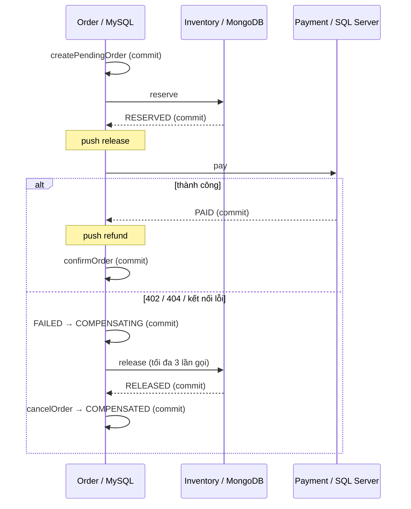
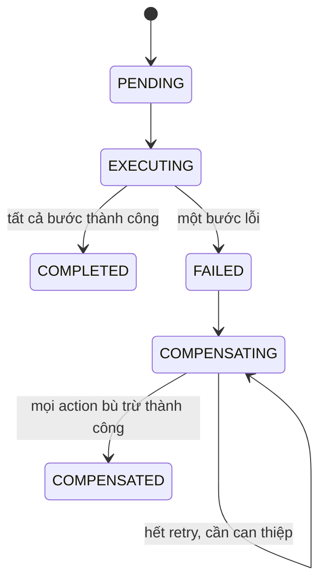

# Transaction và Saga — giải thích từ code Slot 13

## Vì sao một @Transactional không rollback được ba service?

`@Transactional` gắn transaction với transaction manager và connection/session của
**một database**. OrderService quản lý MySQL; InventoryService quản lý MongoDB;
PaymentService quản lý SQL Server. HTTP request sang service khác không truyền
transaction MySQL sang MongoDB hoặc SQL Server.

Ví dụ: Mongo đã commit trừ một P1; SQL Server trả 402 vì C2 chỉ có 100.
Rollback MySQL không cộng lại P1 trong Mongo. Saga phải chủ động gửi `release`.
Saga không cung cấp một ACID transaction xuyên ba database; các local transaction
commit lần lượt và toàn nghiệp vụ đạt nhất quán sau khi hoàn thành hoặc bù trừ.

## Local transaction nào thuộc service nào?

| Bước | Local transaction | Khi thất bại phía sau |
|---|---|---|
| Tạo order | MySQL insert PENDING | cancelOrder → CANCELLED |
| Reserve | MongoDB trừ stock + insert Reservation(RESERVED) | release cộng stock + RELEASED |
| Pay | SQL Server trừ balance + insert Payment(PAID) | refund cộng balance + REFUNDED |
| Confirm | MySQL CONFIRMED + COMPLETED | Nếu confirm thất bại, refund → release → cancel |

Mongo dùng `MongoTransactionManager` và replica set rs0: hai collection nằm trong
cùng một local transaction. Sau khi sửa document phải gọi `save`; Mongo không có
JPA dirty checking. `@Version` phát hiện xung đột concurrent update: transaction
bị conflict rollback thay vì ghi đè tồn kho. Demo không tự retry Mongo write conflict.

SQL Server dùng JPA transaction: dirty checking ghi balance/status lúc commit.
Khóa `PESSIMISTIC_WRITE` trên wallet serialize các lần pay; lookup payment được thực hiện
sau khi lấy khóa để duplicate cùng ví không trừ hai lần. Refund khóa payment và ví.
Tiền dùng `BigDecimal` và DECIMAL(19,2), tránh sai số số thực của `double`.

OrderService là Spring bean khác Orchestrator, nên mỗi lời gọi method `@Transactional`
đi qua proxy và commit khi kết thúc. Log cũng có local transaction riêng.
Orchestrator **không có @Transactional**; không giữ transaction MySQL khi chờ HTTP.

## Điều phối và LIFO

Trong `OrderSagaOrchestrator`, mỗi bước đã trả về thành công mới push compensating
action lên `ArrayDeque`. Push ngay trước log để lỗi ghi log không làm mất action.
Nếu pay lỗi thì stack chỉ có release. Nếu confirm lỗi sau pay thành công thì pop
refund trước, release sau, cuối cùng cancel order. Các unit test kiểm chứng thứ tự này.
Compensation là **transaction mới sửa trạng thái nghiệp vụ**, không phải SQL ROLLBACK
của transaction đã commit. Vì vậy phải lưu reservation/payment để biết cần hoàn bao nhiêu.

## Sáu trạng thái Saga

`OrderStatus` là trạng thái nghiệp vụ: PENDING/CONFIRMED/CANCELLED.
`SagaStatus` phản ánh tiến trình kỹ thuật. Trường hợp KB8: PENDING/COMPENSATING,
không được ghi CANCELLED/COMPENSATED khi hàng chưa trả được.
`SagaLog` ghi từng bước, kết quả, lỗi, thời gian; API trả theo ID tăng dần.
Các trạng thái trung gian được commit nhưng có thể chuyển rất nhanh; log là bằng chứng các bước.

## Idempotent, Reversible, Reliable

- **Idempotent:** orderId là khóa reservation/payment. Cùng payload gọi reserve/pay lại
  trả bản ghi hiện có. Release chỉ tăng kho khi RESERVED; refund chỉ tăng ví khi PAID.
  Gọi lại sau khi bù trừ trả trạng thái RELEASED/REFUNDED, không thực hiện lại tác dụng cũ.
  Cùng orderId nhưng payload khác trả 409.
- **Reversible:** dữ liệu productId/quantity/customerId/amount được giữ để bù đúng tài nguyên;
  cancel giữ order và lý do lỗi cho kiểm toán, không xóa dấu vết.
- **Reliable trong phạm vi demo:** RetryTemplate của Spring Framework 7 dùng
  `maxRetries(2)` = một lần đầu + hai lần thử lại = tối đa **3 lần gọi**.
  Delay một giây, retry RestClientException. Hết lượt giữ COMPENSATING và ghi ba log lỗi.
  Đây là retry hữu hạn, không phải bảo đảm sẽ tự phục hồi mọi sự cố.

Spring xác nhận công thức số lần gọi trong [tài liệu resilience chính thức](https://docs.spring.io/spring-framework/reference/core/resilience.html).
Phiên bản [Spring Boot 4.1.1](https://spring.io/blog/2026/08/20/spring-boot-4-1-1-available-now/)
được giữ đúng theo đề và build từ Maven Central.

## Giới hạn cần nắm khi vấn đáp

1. **Crash recovery:** stack action nằm trong RAM. Dù SagaLog/trạng thái nằm trong DB,
   demo chưa có scheduler/recovery worker đọc lại COMPENSATING sau restart.
   KB8 chứng minh vì sao hệ thống thực cần persisted steps/outbox + worker hoặc Saga engine.
2. **Timeout không chứng minh remote rollback:** participant có thể đã commit nhưng response bị mất.
   Demo push action khi nhận thành công nên chưa giải quyết cửa sổ kết quả không rõ này.
   Hệ thống thực cần tra cứu/retry cùng idempotency key để xác định kết quả rồi reconcile.
   Release/refund đến trước forward command cũng cần tombstone/fencing để tránh forward đến muộn.
3. **Isolation:** service khác có thể đọc kho đã trừ trong lúc Saga chưa hoàn thành;
   Saga không giữ global lock. Reservation/business rules phải xử lý trạng thái trung gian.
4. **Idempotency của API tạo đơn:** mỗi POST /api/orders tạo một order mới;
   idempotency trong bài là ở participant theo orderId, chưa có client idempotency key ở ingress.
5. **Giá và tiền:** API giữ contract của đề, nhận amount từ client. Hệ thống bán hàng thực
   phải tính amount từ giá/khuyến mãi đáng tin cậy và kiểm tra quyền gọi compensation.
6. **Concurrency khác payload:** khóa ví bảo vệ duplicate cùng ví; demo chưa cung cấp
   giao thức idempotency hoàn chỉnh cho hai request đồng thời dùng cùng orderId nhưng khác ví.

## Tự giải thích KB2

C2 mua một P1 giá 1000. MySQL tạo PENDING; Mongo reserve và commit giảm P1 một đơn vị.
SQL Server kiểm tra ví 100, ném 402 trước khi trừ tiền; local transaction pay rollback.
Order ghi FAILED và lý do 402, chuyển COMPENSATING; gọi release để Mongo cộng lại P1.
Cancel order trong MySQL → CANCELLED/COMPENSATED. Không gọi refund vì pay chưa thành công.
Kết quả: order bị hủy có log; tồn kho và ví bằng trước khi Saga bắt đầu.
